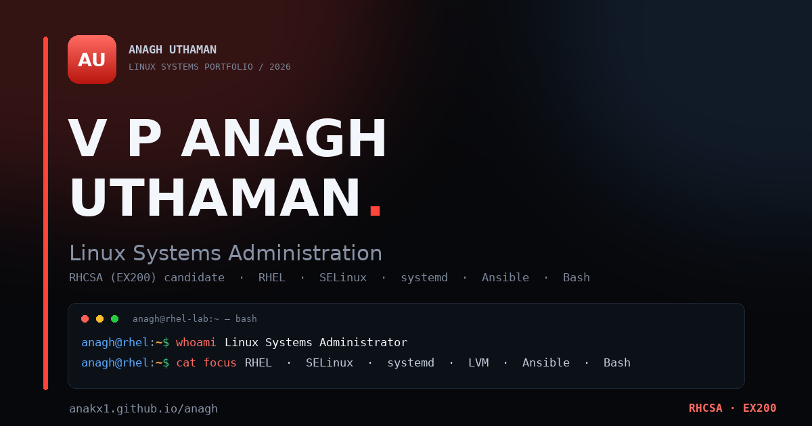

# anagh

Personal portfolio: RHEL labs, Ansible automation, Bash scripting, and RHCSA (EX200) preparation.

**Live:** <https://anakx1.github.io/anagh/>
**Contact:** <dev.an9gh@gmail.com>



A static site with no build step, no dependencies, hosted on GitHub Pages:

- `index.html` — portfolio (hero, about, certifications, skills, projects, selected writing, contact)
- `lab.html` — interactive EX200 command lab and cheat sheet with category filters and search
- `homelab.html` — KVM lab topology, VM inventory, practice areas, and case studies
- `writing.html` — selected lab write-ups: xrdp session failure, SELinux AVC denial, and LVM extend failure
- `resume.html` — print-friendly résumé (use “Print / Save as PDF”)
- `404.html` — themed not-found page
- `assets/styles.css`, `assets/site.js`, `assets/theme.js` — shared styles and behavior
- `assets/fonts.css`, `assets/fonts/*.woff2`, `assets/fonts/LICENSE-*.txt` — self-hosted Inter and JetBrains Mono subsets
- `assets/resume.css`, `assets/resume.js` — résumé layout and print action
- `assets/og-card.png`, `assets/icon-*.png` — social preview and app icons (including the padded maskable icon)
- `site.webmanifest`, `sitemap.xml`, `robots.txt` — install metadata and search indexing
- `.lighthouserc.json` — Lighthouse CI assertions for accessibility, performance, best practices, and SEO
- `.github/workflows/ci.yml` — HTML, JS, Python, link, CSP, font, icon, sitemap, and Lighthouse checks
- `LICENSE`, `LICENSE-CONTENT.md` — MIT code license and all-rights-reserved personal-content notice
- `scripts/check_links.py` — local link, asset, and anchor checker
- `scripts/check_csp.py` — CSP, referrer-policy, and inline-hash checker
- `scripts/make_maskable_icon.py` — regenerates the padded maskable icon from `icon-512.png` (requires Pillow)
- `scripts/summarize_lighthouse.py` — writes the Lighthouse CI score table to the workflow summary and a compact notice annotation
- `docs/github-profile-README.md` — ready-to-copy GitHub profile README for `an9gh`
- `docs/github-profile-settings.md` — matching GitHub bio, website, email, and pinned-repo settings
- `docs/github-repo-metadata.md` — repository descriptions, homepages, and topics

## Preview locally

```bash
python3 -m http.server 8000
# portfolio: http://localhost:8000
# command lab: http://localhost:8000/lab.html
# homelab: http://localhost:8000/homelab.html
# writing: http://localhost:8000/writing.html
# résumé: http://localhost:8000/resume.html
```

## Check before pushing

```bash
npx --yes html-validate@11.17.0 index.html lab.html 404.html resume.html homelab.html writing.html
node --check assets/site.js && node --check assets/resume.js && node --check assets/theme.js
python3 scripts/check_links.py index.html lab.html 404.html resume.html homelab.html writing.html
python3 scripts/check_csp.py index.html lab.html 404.html resume.html homelab.html writing.html
test -s assets/fonts/inter-latin-var.woff2 && test -s assets/fonts/jetbrains-mono-latin-var.woff2 && grep -q 'font-display: swap' assets/fonts.css
test -s assets/icon-maskable-512.png
python3 -m json.tool site.webmanifest >/dev/null
python3 -m json.tool .lighthouserc.json >/dev/null
python3 -c "import xml.etree.ElementTree as ET; ET.parse('sitemap.xml')"
! grep -qE '<(lastmod|changefreq|priority)>' sitemap.xml
test -s LICENSE && test -s LICENSE-CONTENT.md
```

Use Node 22+ (html-validate 11 requires it). The same checks run on every push via GitHub Actions (`.github/workflows/ci.yml`).

## CI

The workflow runs on every push and pull request. The validation job checks HTML, JavaScript syntax, Python helpers, local links and anchors, CSP hashes, referrer policy, self-hosted fonts, app icons, and that `sitemap.xml` contains only `<loc>` entries.

A second job runs Lighthouse CI against a local static server on the homepage, lab, homelab, writing, and résumé pages. Performance fails below `0.9`; accessibility fails below `0.95`; best-practices and SEO emit warnings below `0.9`. Reports are uploaded as the `lighthouse-reports` workflow artifact, and a score table is written to the workflow summary.

On screens `900px` wide and narrower the hero terminal is hidden so the mobile page avoids the terminal's paint cost; the Command Lab remains the mobile interface for the same commands.

## Sitemap

`sitemap.xml` intentionally contains only `<loc>` entries. Google ignores `changefreq` and `priority`, and `lastmod` is not maintained by hand. The CI check rejects those elements so stale dates cannot creep back in.

## Security policy

GitHub Pages does not allow custom HTTP response headers, so each page includes a meta Content-Security-Policy:

- scripts are same-origin only (`script-src 'self'`), with no `'unsafe-inline'`
- styles and fonts are same-origin only; the Google Fonts origins are no longer allowed
- images allow same-origin and `data:` URLs; objects, frames, media, and workers are blocked
- `base-uri` and `form-action` are restricted to the site

The shared theme bootstrap lives in `assets/theme.js` so the main pages do not need inline scripts. `404.html` stays self-contained because GitHub Pages can serve it from arbitrary paths; its inline style and scripts use SHA-256 CSP hashes. `scripts/check_csp.py` verifies those hashes and the referrer policy.

The referrer policy is `strict-origin-when-cross-origin`, so cross-origin links receive only the origin and no path.

## Fonts

Inter and JetBrains Mono are self-hosted as variable WOFF2 subsets in `assets/fonts/`. The subsets cover printable ASCII, Latin-1 accents, typographic punctuation, and the arrows used in the UI. Both use `font-display: swap`; Inter is preloaded on every page. `404.html` uses root-absolute font URLs because it can be served from arbitrary paths. Both families are licensed under the SIL Open Font License 1.1; the license texts are in `assets/fonts/`.

## App icons

`assets/icon-512.png` remains the standard `any` icon. `assets/icon-maskable-512.png` is the dedicated maskable icon: it keeps the full-bleed red gradient and scales the “AU” lettering to 76% of its original size, leaving 82px of margin inside Android’s central 80% safe zone. Regenerate it with:

```bash
python3 scripts/make_maskable_icon.py
```

## Progressive enhancement

`assets/theme.js` adds the `js` class before `styles.css` loads. `.reveal` content is only hidden under `.js .reveal`, so it remains visible when JavaScript is disabled. The terminal hides its chips, clear button, and input row without JavaScript and shows a `<noscript>` note linking to the Command Lab. The Command Lab hides its filter controls without JavaScript, shows all command cards, and displays a `<noscript>` note.

## License

The source code — HTML, CSS, JavaScript, Python, and shell scripts — is released under the MIT License; see `LICENSE`.

The personal content — résumé, writing, site copy, images, icons, and branding — is © 2026 V P Anagh Uthaman, all rights reserved; see `LICENSE-CONTENT.md`.

Third-party fonts remain under the SIL Open Font License 1.1; see `assets/fonts/LICENSE-*.txt`.

## GitHub profile

`docs/github-profile-README.md` contains the corrected profile README: RHCSA Rapid Track (RH199) completion, EX200 preparation, RHCE coursework, the portfolio link, and `dev.an9gh@gmail.com`.

To publish it from a machine authenticated as `an9gh`:

```bash
gh auth login
./scripts/publish-github-profile.sh
```

The current SSH key on this machine is authenticated as `anakx1`, so the profile repo must be updated from an `an9gh` session.

## Deploy

Repo **Settings → Pages → Deploy from a branch → `main` / root**.

The site uses the default `anakx1.github.io/anagh` URL, so no `CNAME` file is committed. Add a `CNAME` only if you adopt a custom domain.

## Keep fresh

Update the “Currently” line in `index.html` whenever your focus changes. Update the cheat sheet cards in `lab.html` when your command references change. Add new entries to `writing.html` and the Selected writing section in `index.html` when a lab produces a reusable lesson. When you add or remove a page, update `sitemap.xml`; keep it to `<loc>` entries only. Keep `docs/github-profile-README.md` in sync with the site.
